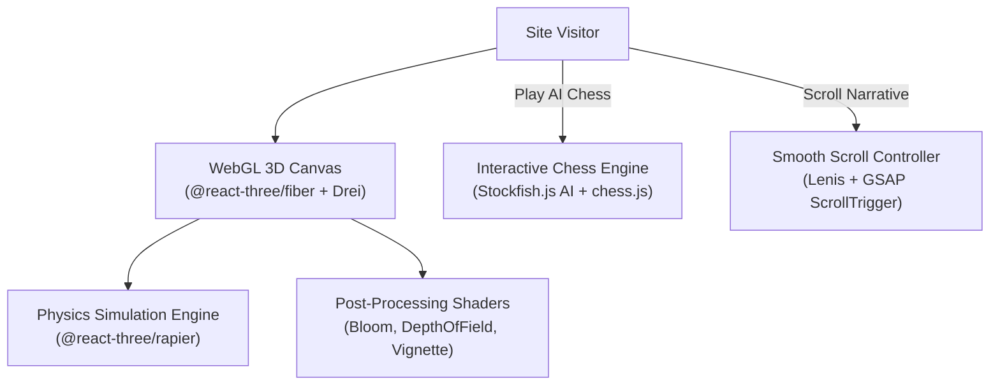

# 🌐 Narasimha Manam — 3D Interactive Engineering Portfolio

[](https://react.dev/)
[](https://threejs.org/)
[](https://www.typescriptlang.org/)
[](https://vitejs.dev/)
[](https://greensock.com/gsap/)
[](https://vercel.com)

The personal, 3D interactive engineering portfolio of **Narasimha Manam**. Built using **React Three Fiber (R3F)**, **Three.js**, **GSAP**, **TypeScript**, and **Vite**, this application combines physics simulations, custom WebGL shaders, smooth Lenis scrolling, and an interactive 3D chess game engine integrated with **Stockfish AI**.

---

## 🎨 Interactive Features & Architecture



### Highlights:
- **WebGL 3D Canvas:** Interactive 3D scene rendering via React Three Fiber and Drei utilities.
- **Physics Engine:** Real-time rigid-body collisions powered by Rapier (`@react-three/rapier`).
- **Stockfish AI Chess Mini-Game:** Embedded playable chess match against the open-source Stockfish engine running client-side in WebAssembly (`stockfish.js` + `chess.js`).
- **Smooth Inertial Scrolling:** Lenis smooth scrolling coupled with GSAP timeline scroll-trigger animations.
- **Responsive Post-Processing:** Tone mapping, subtle bloom, and depth-of-field optimized for 60fps performance on mobile and desktop GPUs.

---

## 🛠️ Technology Stack

- **Core Framework:** React 18, Vite 5, TypeScript 5
- **3D & Graphics:** Three.js (`three`), `@react-three/fiber`, `@react-three/drei`, `@react-three/postprocessing`
- **Physics:** `@react-three/rapier`, `@react-three/cannon`
- **Animations:** GSAP (GreenSock), Lenis smooth scroll
- **Game Engine:** `stockfish.js`, `chess.js`
- **Icons & UI:** Lucide React, React Icons, React Fast Marquee
- **Deployment:** Vercel (`vercel.json`)

---

## 📂 Project Structure

```
portfolio/
├── public/                   # Static 3D models, textures, and assets
├── scripts/                  # Optimization & build scripts
├── src/
│   ├── components/           # 3D canvas, hero sections, project showcases
│   ├── hooks/                # Viewport and GPU capability hooks
│   ├── pages/                # Page routes (Home, Projects, Chess)
│   ├── App.tsx
│   └── main.tsx
│
├── vercel.json               # Vercel SPA routing and caching headers
├── package.json
├── tsconfig.json
└── vite.config.ts
```

---

## 🚀 Quickstart & Local Setup

### Prerequisites
- Node.js `18.x` or higher
- `npm` or `pnpm`

### 1. Clone the Repository
```bash
git clone https://github.com/Narasimhamanam/portfolio.git
cd portfolio
```

### 2. Install Dependencies
```bash
npm install
```

### 3. Launch Development Server
```bash
npm run dev
# Opens at http://localhost:5173
```

### 4. Build for Production
```bash
npm run build
npm run preview
```

---

## ⚠️ Performance Notes

- The 3D canvas automatically scales device pixel ratio (`dpr={[1, 2]}`) to prevent overheating or GPU throttling on high-DPI retina screens.
- WebGL contexts automatically handle tab hibernation and context restoration gracefully.
